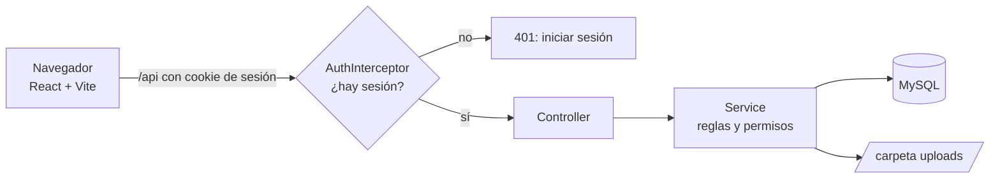
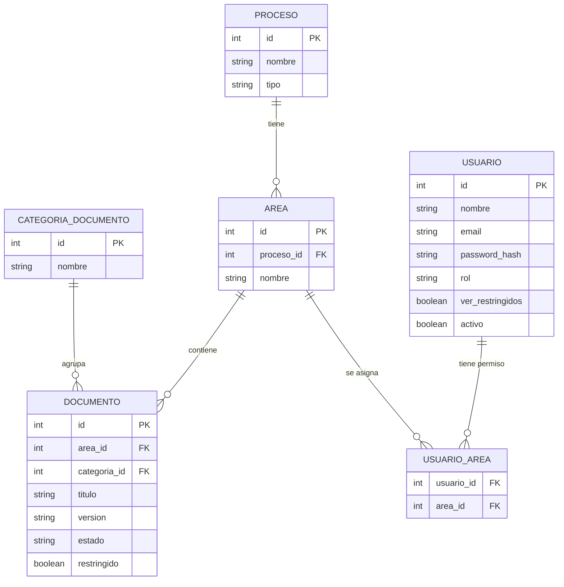

# SGC CESDE — Sistema de Gestión de Calidad digital

Aplicación web interactiva que digitaliza el Sistema de Gestión de Calidad (SGC) del CESDE. Permite consultar y administrar la documentación institucional organizada por **proceso**, **área** y **categoría**, a partir del mapa estratégico de procesos que hoy está en Genially. Cada persona entra con su cuenta y ve solo lo que su perfil y sus áreas le permiten.

## Contenido

1. [Qué permite hacer](#qué-permite-hacer)
2. [Perfiles y permisos](#perfiles-y-permisos)
3. [Estructura del repositorio](#estructura-del-repositorio)
4. [Tecnologías](#tecnologías)
5. [Cómo ejecutarlo](#cómo-ejecutarlo)
6. [Guía de uso por perfil](#guía-de-uso-por-perfil)
7. [Arquitectura](#arquitectura)
8. [Modelo de datos](#modelo-de-datos)
9. [Seguridad: cómo funciona el acceso](#seguridad-cómo-funciona-el-acceso)
10. [API](#api)
11. [Archivos subidos](#archivos-subidos)
12. [Pruebas rápidas desde la terminal](#pruebas-rápidas-desde-la-terminal)
13. [Flujo de trabajo (Git)](#flujo-de-trabajo-git)
14. [Solución de problemas](#solución-de-problemas)
15. [Límites actuales y fase 2](#límites-actuales-y-fase-2)
16. [Equipo](#equipo)

## Qué permite hacer

- Navegar el mapa estratégico de procesos (estratégico, misionales, de apoyo y de control) y sus **9 áreas**, representado como la **Ciudad CESDE**: cada edificio es un área.
- Ver las **7 categorías** documentales de cada área: Caracterización, Procedimientos, Formatos, Documentos, Riesgos, Indicadores y Planes de mejora.
- **Iniciar sesión** con correo y contraseña, con tres perfiles: lector, consultor y administrador.
- Ver cada persona **solo las áreas** que se le asignaron.
- Marcar documentos como **restringidos**, visibles solo para administradores y para quienes tengan ese permiso (por ejemplo, "Revisión por la dirección").
- **Subir** documentos (PDF, Word, Excel, PowerPoint e imágenes), **verlos** en el navegador y **descargarlos**, según el perfil.
- **Buscar** documentos por título o descripción.
- **Administrar usuarios**: crear cuentas, cambiar perfil y áreas, activar o desactivar, y restablecer contraseñas.

## Perfiles y permisos

| Acción | Lector | Consultor | Administrador |
|---|---|---|---|
| Ver la portada (Ciudad CESDE) sin iniciar sesión | Sí | Sí | Sí |
| Ver documentos en pantalla | Sí | Sí | Sí |
| Descargar documentos | No | Sí | Sí |
| Subir, editar y eliminar documentos | No | No | Sí |
| Gestionar usuarios | No | No | Sí |
| Áreas que ve | Las asignadas | Las asignadas | Todas |
| Documentos restringidos | Solo con permiso | Solo con permiso | Todos |

Reglas que se combinan:

1. **Por área.** A cada usuario se le asignan áreas. Si no tiene ninguna, no ve documentos. El administrador ve todas.
2. **Por documento restringido.** Un documento restringido solo lo ven los administradores y los usuarios con el permiso "Puede ver documentos restringidos" (pensado para cargos directivos).
3. **Por perfil.** Descargar está vetado al lector; subir, editar, eliminar y gestionar usuarios son solo del administrador.

Todas estas reglas **las valida el backend**. Ocultar un botón en la pantalla es solo comodidad: si alguien intenta una acción sin permiso (por ejemplo, escribiendo la dirección a mano), el backend responde `403`.

## Estructura del repositorio

| Carpeta | Contenido |
|---|---|
| `sgc-api/` | Backend: API REST con Spring Boot 4, Java 21 y MySQL |
| `src/` | Frontend: React, Vite y Tailwind CSS |
| `database/` | Scripts de la base de datos (`schema.sql`, `seed.sql` y `002_login.sql`) |
| `docs/` | Diagrama entidad-relación |

**Backend** (`sgc-api/src/main/java/co/cesde/sgc_api/`):

| Carpeta | Qué contiene |
|---|---|
| `auth/` | Login, sesión, contraseñas y administración de usuarios (`AuthController`, `AuthInterceptor`, `PasswordHasher`, `UsuarioService`, `UsuarioController`, `AdministracionUsuarios`, `AdministradorInicial`, `UsuarioSesion`) |
| `documento/` | Documentos: `DocumentoController`, `DocumentoService`, `DocumentoDto` |
| `controller/` | Procesos y categorías (`ProcesoController`) y comprobación de estado (`/health`) |
| `config/` | Configuración de CORS |
| `dto/`, `repository/` | Objetos de respuesta y acceso a datos de procesos, áreas y categorías |

**Frontend** (`src/`):

| Carpeta | Qué contiene |
|---|---|
| `pages/` | Pantallas: `Home` (la ciudad), `Login`, `VistaProceso` (el archivador de un área), `VistaCategoria` (los documentos) y `Usuarios` (administración) |
| `components/` | `Marco` (cabecera y pie), `CiudadCesde`, `Carpi` (la mascota), modales de subir y ver documentos, `RutaProtegida` |
| `context/` | `Sesion.jsx`: guarda quién es el usuario conectado y sus permisos |
| `services/` | `http.js` (pedidos al backend), `authApi.js` (sesión y usuarios) y `documentosApi.js` (documentos) |
| `data/` | `estructura.js`: procesos, áreas y categorías (los ids coinciden con `seed.sql`) |

## Tecnologías

| Capa | Tecnología |
|---|---|
| Frontend | React 19, Vite, Tailwind CSS 4, React Router, Framer Motion |
| Backend | Spring Boot 4 (Java 21), Spring Data JPA y JdbcTemplate |
| Base de datos | MySQL 8 |
| Sesión | Cookie de sesión (`JSESSIONID`) del servidor |
| Contraseñas | PBKDF2 con HMAC-SHA256, sal aleatoria y 600.000 repeticiones |

## Cómo ejecutarlo

### Requisitos

- Java 21
- MySQL 8
- Node.js 20.19 o superior (se recomienda 22 o 24; con Node 18 el frontend no arranca)

### 1. Base de datos

Abre MySQL (cliente de línea de comandos, Workbench o phpMyAdmin) y ejecuta **en este orden**:

```sql
source C:/ruta/al/proyecto/database/schema.sql
source C:/ruta/al/proyecto/database/seed.sql
source C:/ruta/al/proyecto/database/002_login.sql
```

- `schema.sql`: crea la base de datos y las tablas de procesos, áreas, categorías y documentos.
- `seed.sql`: carga los 4 procesos, las 9 áreas y las 7 categorías.
- `002_login.sql`: crea las tablas `usuario` y `usuario_area` y agrega la marca `restringido` a los documentos.

Verifica: `SELECT * FROM cesde_sgc.area;` debe devolver 9 áreas, y `SHOW TABLES;` debe incluir `usuario` y `usuario_area`.

> **Ojo:** `schema.sql` borra y vuelve a crear las tablas. Si lo ejecutas de nuevo se pierden los registros, y debes volver a ejecutar `seed.sql` y `002_login.sql`.
>
> **En MySQL Command Line Client:** escribe cada `source` en su propia línea y sin punto y coma al final.

### 2. Backend

Ninguna contraseña se guarda en el repositorio: se entregan con variables de entorno.

| Variable | Obligatoria | Para qué sirve |
|---|---|---|
| `DB_PASSWORD` | Sí | Contraseña del usuario `root` de MySQL |
| `ADMIN_PASSWORD` | La primera vez | Contraseña del administrador inicial (mínimo 8 caracteres) |
| `ADMIN_EMAIL` | No | Correo del administrador inicial. Por defecto: `admin@cesde.edu.co` |
| `STORAGE_DIR` | No | Carpeta donde se guardan los archivos. Por defecto: `uploads` |

**Windows (PowerShell):**

```powershell
cd sgc-api
$env:DB_PASSWORD='tu_contraseña_de_mysql'
$env:ADMIN_PASSWORD='una_contraseña_larga_para_el_administrador'
.\mvnw.cmd spring-boot:run
```

**macOS / Linux:**

```bash
cd sgc-api
export DB_PASSWORD='tu_contraseña_de_mysql'
export ADMIN_PASSWORD='una_contraseña_larga_para_el_administrador'
./mvnw spring-boot:run
```

Cuando en la consola aparezca `Started SgcApiApplication`, abre <http://localhost:8080/health>. Debe responder `{"status":"ok"}`.

**El administrador inicial** se crea solo al arrancar, y únicamente si la tabla `usuario` está vacía. Después de ese primer arranque, `ADMIN_PASSWORD` ya no se usa: la contraseña vive en la base de datos y se cambia desde la pantalla **Usuarios**.

### 3. Frontend

En la raíz del repositorio, en otra terminal:

```bash
npm install
npm run dev
```

Abre la dirección que muestra la terminal (normalmente <http://localhost:5173>). Las rutas `/api` se reenvían al backend (`http://localhost:8080`) mediante el proxy configurado en `vite.config.js`, así que el backend debe estar encendido.

### 4. Primer ingreso

1. Abre <http://localhost:5173> y pulsa **Iniciar sesión**.
2. Entra con `admin@cesde.edu.co` y la contraseña que pusiste en `ADMIN_PASSWORD`.
3. Entra a **👥 Usuarios** y crea las cuentas de lector y consultor con las áreas que corresponda.

## Guía de uso por perfil

### Todas las personas

- **Portada:** la Ciudad CESDE se ve sin iniciar sesión. Si tocas un edificio, la aplicación te pide iniciar sesión y, al entrar, te lleva a esa área.
- **Entrar a un área:** toca un edificio → se abre el archivador con las 7 carpetas → entra a una carpeta para ver sus documentos.
- **Buscar:** la barra de la cabecera busca áreas y documentos. Solo muestra lo que tienes permitido ver.
- **Salir:** el botón 🚪 de la cabecera cierra la sesión.
- Un documento con 🔒 es restringido.

### Lector

- Ve los documentos con el botón **Ver**.
- No tiene botón de descarga ni de subir.
- Solo ve las áreas que le asignaron.

### Consultor

- Hace lo mismo que el lector y además puede **descargar** los archivos.

### Administrador

- Ve las 9 áreas y todos los documentos, incluidos los restringidos.
- **Subir un documento:** entra a la carpeta, pulsa **+ Subir documento**, elige el archivo, escribe el título (y, si quieres, la versión y la descripción) y, si es de acceso limitado, marca **🔒 Documento restringido**.
- **Gestionar usuarios** (botón **👥 Usuarios** de la cabecera):
  - **+ Nuevo usuario:** nombre, correo, contraseña inicial (mínimo 8 caracteres), perfil y áreas.
  - **Editar:** cambia nombre, perfil, permiso de ver restringidos, áreas y si la cuenta está activa.
  - **Desactivar:** la persona ya no puede entrar. No se borra nada.
  - **Contraseña:** define una contraseña nueva; la anterior deja de servir al instante.
  - El sistema no deja desactivar ni bajar de perfil al **único administrador activo**.

## Arquitectura



- El **Controller** recibe el pedido, el **Service** aplica las reglas y los permisos, y la base de datos (o la carpeta `uploads`) guarda y entrega la información.
- El **AuthInterceptor** vigila todas las rutas `/api/**` (menos el login): en cada pedido carga al usuario desde la base de datos. Por eso un cambio de perfil, de áreas o una cuenta desactivada se aplica de inmediato.
- Los documentos y los usuarios usan SQL directo (`JdbcTemplate`); procesos, áreas y categorías usan JPA.

## Modelo de datos



| Tabla | Para qué sirve |
|---|---|
| `proceso` | Los 4 tipos del mapa: estratégico, misional, de apoyo y de control |
| `area` | Las 9 áreas (Rectoría, Dirección Académica, Jurídica, etc.) |
| `categoria_documento` | Las 7 categorías fijas |
| `documento` | Cada archivo: título, versión, estado (`vigente` u `obsoleto`), área, categoría y marca `restringido` |
| `usuario` | Cada cuenta: correo, contraseña en forma de hash, perfil (`lector`, `consultor`, `administrador`), permiso `ver_restringidos` y si está `activo` |
| `usuario_area` | Qué áreas puede ver cada usuario (relación de muchos a muchos) |

El archivo físico no vive en la base de datos: se guarda en la carpeta `uploads` y la tabla `documento` guarda su ruta y sus datos. La API solo lista los documentos vigentes.

## Seguridad: cómo funciona el acceso

- **Sesión por cookie.** Al iniciar sesión, el servidor crea una sesión y entrega la cookie `JSESSIONID`, marcada como `HttpOnly` (el código de la página no puede leerla) y `SameSite=Lax`. Las sesiones viven en la memoria del servidor: si el backend se reinicia, todos deben iniciar sesión de nuevo.
- **Contraseñas.** Nunca se guardan tal como se escriben. Se guarda un hash PBKDF2-HMAC-SHA256 con sal aleatoria y 600.000 repeticiones, con formato `repeticiones:sal:hash`. Comprobar una contraseña tarda cerca de medio segundo, a propósito.
- **Mensaje único en el login.** Si el correo o la clave fallan, la respuesta es la misma ("Correo o contraseña incorrectos"), para no revelar qué correos existen.
- **Permisos en el servidor.** Cada petición se valida en el backend (área, restringido, perfil). Los botones ocultos de la pantalla son solo comodidad.
- **Archivos.** Solo se aceptan 10 extensiones, hasta 20 MB, con el nombre revisado y guardados con un nombre aleatorio. Solo el administrador puede subir.
- **Sin credenciales en el repositorio.** Las contraseñas llegan por variables de entorno. No subas a Git archivos `.env`, archivos de prueba con claves ni cookies.

## API

URL base: `http://localhost:8080`. Todo lo que empieza con `/api` exige sesión, salvo el login.

### Códigos de respuesta

| Código | Significa |
|---|---|
| `200` / `201` / `204` | Todo bien / se creó algo / hecho, sin contenido |
| `400` | El dato enviado no sirve (el JSON trae el motivo en `message`) |
| `401` | No hay sesión o es incorrecta: la pantalla debe llevar al login |
| `403` | Hay sesión, pero no tienes permiso |
| `404` | No existe |
| `409` | Choca con algo existente (correo repetido, o quitar al único administrador) |

Los errores llegan como JSON con el campo `message`.

### Sesión

| Método | Ruta | Quién | Descripción |
|---|---|---|---|
| POST | `/api/auth/login` | Cualquiera | Inicia sesión con `{"email": "...", "clave": "..."}` |
| GET | `/api/auth/me` | Con sesión | Datos del usuario conectado: `id`, `nombre`, `email`, `rol`, `verRestringidos`, `areas` |
| POST | `/api/auth/logout` | Con sesión | Cierra la sesión (204) |

### Documentos y estructura

| Método | Ruta | Quién | Descripción |
|---|---|---|---|
| GET | `/health` | Cualquiera | Comprueba que el backend funciona |
| GET | `/api/categorias` | Con sesión | Las 7 categorías, ordenadas |
| GET | `/api/procesos` | Con sesión | Los procesos con las áreas que el usuario puede ver |
| GET | `/api/documentos` | Con sesión | Documentos vigentes permitidos. Filtros opcionales: `areaId`, `categoriaId`, `q` |
| GET | `/api/documentos/{id}` | Con sesión | Datos de un documento |
| GET | `/api/documentos/{id}/archivo` | Con sesión | Muestra el archivo en el navegador |
| GET | `/api/documentos/{id}/archivo?descargar=true` | Consultor y administrador | Descarga el archivo |
| POST | `/api/documentos` | Administrador | Sube un documento |
| PUT | `/api/documentos/{id}` | Administrador | Edita título, descripción, versión y `restringido` |
| DELETE | `/api/documentos/{id}` | Administrador | Elimina el documento y su archivo (204) |

**Parámetros de `POST /api/documentos`** (formato `multipart/form-data`):

| Campo | Obligatorio | Descripción |
|---|---|---|
| `archivo` | Sí | El archivo a subir |
| `areaId` | Sí | Id del área (1 a 9) |
| `categoriaId` | Sí | Id de la categoría (1 a 7) |
| `titulo` | Sí | Hasta 200 caracteres |
| `descripcion` | No | Hasta 500 caracteres |
| `version` | No | Por defecto `1.0` (hasta 20 caracteres) |
| `restringido` | No | `true` o `false` (por defecto `false`) |

**Ejemplo de documento:**

```json
{
  "id": 1,
  "areaId": 9,
  "categoriaId": 2,
  "titulo": "Documento de prueba",
  "descripcion": null,
  "archivoNombre": "prueba.png",
  "tipoArchivo": "png",
  "tamanoBytes": 78200,
  "version": "1.0",
  "estado": "vigente",
  "fechaActualizacion": "2026-10-22T21:14:57",
  "restringido": false
}
```

### Usuarios (solo administrador)

| Método | Ruta | Descripción |
|---|---|---|
| GET | `/api/usuarios` | Lista de usuarios: `id`, `nombre`, `email`, `rol`, `verRestringidos`, `activo`, `areas` (nunca incluye la contraseña) |
| POST | `/api/usuarios` | Crea un usuario: `nombre`, `email`, `clave` (mínimo 8), `rol`, `verRestringidos`, `areas` (lista de ids). Responde `201` con `{"id": ...}`; `409` si el correo ya existe |
| PUT | `/api/usuarios/{id}` | Edita cualquiera de `nombre`, `rol`, `verRestringidos`, `activo`, `areas`. Lo que no se envía se conserva. `409` si dejaría al sistema sin administrador activo |
| PUT | `/api/usuarios/{id}/clave` | Define una contraseña nueva: `{"clave": "..."}` (204) |

El `rol` es `lector`, `consultor` o `administrador`. Los ids de las áreas son:

| Id | Área | Id | Área |
|---|---|---|---|
| 1 | Rectoría | 6 | Vicerrectoría Administrativa y Financiera |
| 2 | Dirección Académica | 7 | Proyectos y Empleo |
| 3 | Conexión de Negocios | 8 | Comunicaciones |
| 4 | Jurídica | 9 | Auditoría y Calidad |
| 5 | Talento Cesde | | |

## Archivos subidos

- Formatos permitidos: `pdf`, `doc`, `docx`, `xls`, `xlsx`, `ppt`, `pptx`, `png`, `jpg`, `jpeg`.
- Tamaño máximo: **20 MB** por archivo.
- Los archivos se guardan en `sgc-api/uploads/{areaId}/{categoriaId}/`. Se puede cambiar la carpeta con la variable de entorno `STORAGE_DIR`.
- Git ignora esa carpeta: **los archivos subidos en un computador no aparecen en el de otra persona**, aunque la base de datos tenga el registro.

## Pruebas rápidas desde la terminal

Con el backend encendido, estos comandos (PowerShell) prueban el acceso y los permisos. Usa una carpeta **fuera del repositorio** y bórrala al terminar: los archivos de prueba contienen contraseñas y sesiones.

```powershell
mkdir C:\cesde-prueba; cd C:\cesde-prueba

# 1. Sin sesión: debe responder 401
curl.exe -s -o NUL -w "sin sesion: %{http_code}\n" http://localhost:8080/api/documentos

# 2. Iniciar sesión (guarda la cookie en admin.txt). Cambia TU_CLAVE por la contraseña del administrador
Set-Content -Encoding ascii -Path login.json -Value '{"email":"admin@cesde.edu.co","clave":"TU_CLAVE"}'
curl.exe -s -o NUL -w "login: %{http_code}\n" -c admin.txt -X POST http://localhost:8080/api/auth/login -H "Content-Type: application/json" -d "@login.json"

# 3. Subir un documento (archivo pequeño, con ruta sin espacios)
curl.exe -i -b admin.txt -X POST http://localhost:8080/api/documentos -F "archivo=@C:/cesde-prueba/prueba.png" -F "areaId=9" -F "categoriaId=2" -F "titulo=Documento de prueba" -F "restringido=false"

# 4. Listar y eliminar (cambia el 1 por el id que devolvió la subida)
curl.exe -s -b admin.txt http://localhost:8080/api/documentos
curl.exe -i -b admin.txt -X DELETE http://localhost:8080/api/documentos/1
```

Para probar los otros perfiles, crea un usuario desde la pantalla **Usuarios**, inicia sesión con él (guardando su propia cookie) y repite los pedidos: las acciones no permitidas deben responder `403`.

## Flujo de trabajo (Git)

- Nadie trabaja directamente en `main` ni en `dev`.
- Cada tarea va en su rama `feature/nombre-corto`, creada desde `dev`.
- Se sube la rama y se abre un Pull Request hacia `dev`; otra persona del equipo lo revisa antes de unirlo.
- `dev` se une a `main` solo al cierre de cada sprint.
- Nunca se suben contraseñas, archivos `.env`, la carpeta `.idea`, `node_modules` ni `uploads`.
- Se suben solo las carpetas en las que se trabajó (por ejemplo, `git add src`), no todo con `git add .`.

## Solución de problemas

| Síntoma | Causa probable y solución |
|---|---|
| `npm run dev` falla con `styleText` | Node es demasiado viejo. Usa Node 20.19 o superior (`node -v` para revisar). |
| El frontend dice "No se pudo conectar con el servidor" | El backend está apagado o MySQL no está prendido. |
| El backend no arranca: `Access denied for user 'root'` | La variable `DB_PASSWORD` no está definida o es incorrecta. |
| El backend no arranca: `Communications link failure` | MySQL está apagado o usa otro puerto. |
| Puerto 8080 ocupado | Hay otra copia del backend abierta. Ciérrala con `Ctrl + C`. |
| No puedo iniciar sesión con el administrador | `ADMIN_PASSWORD` solo se usa cuando la tabla `usuario` está vacía. Si ya existe, usa la contraseña vigente, o cámbiala desde la pantalla Usuarios con otra cuenta de administrador. |
| En el log: "falta la variable ADMIN_PASSWORD" | No hay usuarios y no definiste `ADMIN_PASSWORD`. Defínela y reinicia el backend. |
| En el log: "¿Ejecutaste database/002_login.sql?" | Faltan las tablas de usuarios. Ejecuta `002_login.sql`. |
| Todo responde 401 o vuelve al login | La sesión se perdió (por ejemplo, el backend se reinició). Inicia sesión de nuevo. |
| Un documento no se ve o no se descarga: 403 | El perfil no lo permite, el área no está asignada o el documento es restringido. |
| Al subir, no responde nada o dice que el archivo es muy grande | El archivo supera los 20 MB. |
| Un documento aparece, pero no abre | El archivo no está en `sgc-api/uploads` de este computador (ver la sección de archivos subidos). |
| Error `Duplicate column name 'restringido'` al ejecutar `002_login.sql` | Ya se ejecutó antes. No es un problema. |

## Límites actuales y fase 2

**Listo:** modelo de datos, API de documentos (listar, buscar, subir, ver, descargar, editar y eliminar), login con sesión, tres perfiles, permisos por área, documentos restringidos, administración de usuarios y mapa interactivo (Ciudad CESDE) con navegación proceso → área → categoría → documentos.

**Límites conocidos** (el proyecto es una entrega académica y una demo, no un sistema listo para producción):

- No hay límite de intentos de login ni protección contra CSRF (la cookie `SameSite=Lax` ayuda en parte).
- No hay HTTPS: el tráfico viaja sin cifrar en la red local.
- Las sesiones viven en la memoria del servidor y se pierden al reiniciarlo.
- Los archivos se guardan en el disco de cada computador, no en un lugar compartido.
- Cada persona no puede cambiar su propia contraseña; hoy solo la restablece el administrador.
- El lector no puede descargar (el backend lo niega), pero el visor de PDF del navegador puede ofrecer guardar el archivo. Evitarlo del todo requiere otro tipo de visor.
- La interfaz no tiene botón de eliminar documentos (la API sí lo permite, solo para administradores).
- La estructura del mapa (procesos, áreas y categorías) sale de `src/data/estructura.js`; los endpoints `/api/procesos` y `/api/categorias` ya están disponibles para conectarla con la base de datos.
- No hay pruebas automáticas: las pruebas se hicieron a mano, con los tres perfiles.

**Fase 2 propuesta:**

- Cambio de contraseña por la propia persona y recuperación de contraseña.
- Límite de intentos de login, HTTPS y sesiones persistentes.
- Spring Security en lugar del control de acceso propio.
- Almacenamiento compartido de los archivos y publicación en un servidor.
- Control de versiones de documentos (historial) y botón de eliminar protegido por permisos.
- Registro de actividad (quién subió o descargó qué).
- Pruebas automáticas.

## Equipo

Proyecto universitario en equipo, con metodología Scrum y trabajo en GitHub (ramas `feature/*` → `dev` → `main`).

| Rol | Persona |
|---|---|
| Backend y base de datos (líder) | Cristina |
| Frontend | mafe-code |
| Diseño | Genesis |
